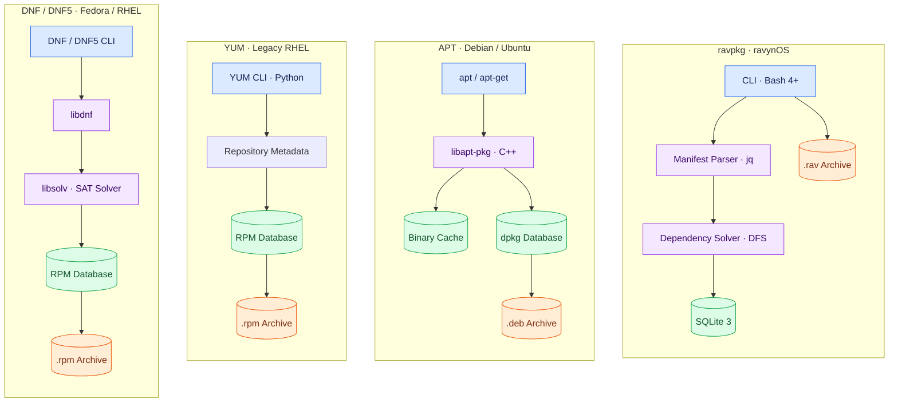
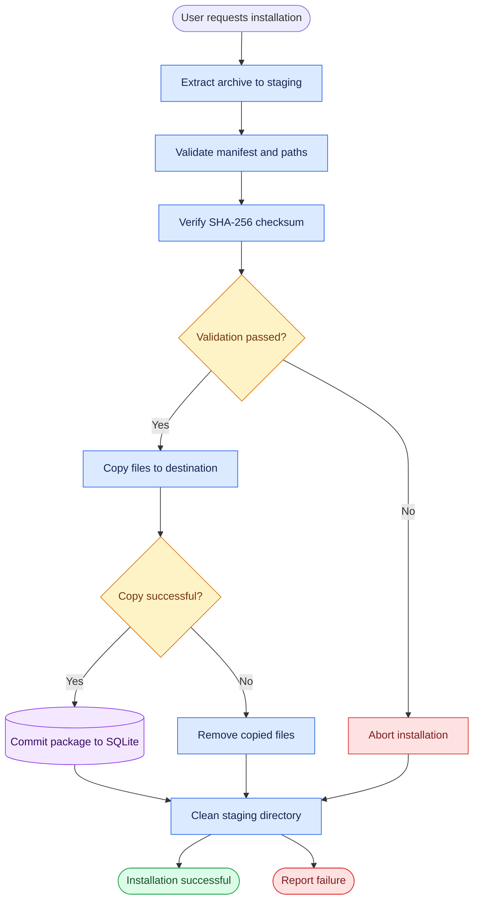
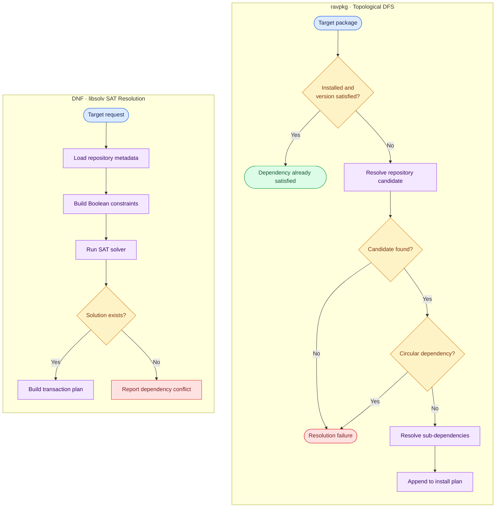

# Comprehensive Performance Benchmark & Architectural Analysis: `ravpkg` vs. `apt`, `yum`, and `dnf`

**Document Version:** 2.0.0  
**Target System:** ravynOS (Darwin/FreeBSD userland)  
**Implementation:** Pure Bash 4+ with SQLite 3 and `jq`  
**Test Suite:** `tests/benchmark.sh` (Phases 1–4)  
**Status:** All 56 Bats unit & integration tests passing (`56/56 OK`)

---

## 1. Executive Summary

`ravpkg` is the native package manager for **ravynOS**, an open-source operating system providing macOS desktop and application compatibility on top of a Darwin/FreeBSD userland. Unlike traditional Linux package managers (`apt`, `yum`, `dnf`) that rely on compiled C/C++ libraries (`libapt-pkg`, `libsolv`) or heavy Python runtimes, `ravpkg` is built entirely in **pure Bash**, backed by an embedded **SQLite 3** relational database and **jq** for JSON manipulation.

This report documents:

1. **Empirical Performance Benchmarks:** Measured wall-clock timings across all package manager operations, including manifest parsing, database index queries, semantic version evaluation, repository search, graph dependency resolution, and transactional package lifecycle.
2. **Comparative Architectural Analysis:** A detailed comparison of `ravpkg` against Debian/Ubuntu's **APT**, legacy Red Hat **YUM**, and modern Fedora/RHEL **DNF**.
3. **Structured Visual Models:** Mermaid diagrams illustrating package manager architectures, transactional rollback lifecycles, dependency resolution algorithms, and latency profiles.

---

## 2. Measured Benchmark Observations

The benchmarks below were measured on **2026-10-20** on an x86_64 host using **Bash 5.3.9**, **SQLite 3.46.1**, and **jq 1.8.1**. Each benchmark operation was executed across **10 independent iterations** to calculate minimum, maximum, arithmetic mean, and median latencies.

### Summary Data Table

| # | Benchmark Operation | Scale / Dataset | Min | Max | Mean | Median |
| :-: | :--- | :--- | :---: | :---: | :---: | :---: |
| **1** | **Manifest Parse** | Single valid manifest (`valid-manifest.json`) | 33.20 ms | 37.37 ms | 34.62 ms | **34.41 ms** |
| **2** | **Manifest Parse** | Batch 100 synthetic manifests | 1,950.21 ms | 2,130.84 ms | 2,026.97 ms | **2,029.09 ms** |
| **3** | **`ravpkg info`** | 10 packages in SQLite DB | 115.39 ms | 120.17 ms | 117.87 ms | **117.47 ms** |
| **4** | **`ravpkg info`** | 100 packages in SQLite DB | 116.87 ms | 121.29 ms | 119.41 ms | **119.55 ms** |
| **5** | **`ravpkg info`** | 1,000 packages in SQLite DB | 101.57 ms | 128.88 ms | 114.79 ms | **114.63 ms** |
| **6** | **`ravpkg info`** | 10,000 packages in SQLite DB | 104.49 ms | 110.95 ms | 106.49 ms | **105.61 ms** |
| **7** | **`ravpkg list`** | 10 packages in SQLite DB | 79.76 ms | 83.80 ms | 82.29 ms | **82.42 ms** |
| **8** | **`ravpkg list`** | 100 packages in SQLite DB | 86.30 ms | 146.40 ms | 94.06 ms | **88.44 ms** |
| **9** | **`ravpkg list`** | 1,000 packages in SQLite DB | 135.56 ms | 151.66 ms | 142.54 ms | **141.11 ms** |
| **10** | **`ravpkg list`** | 10,000 packages in SQLite DB | 700.26 ms | 783.81 ms | 723.99 ms | **711.90 ms** |
| **11** | **Semver Evaluation** | 50 operations (`semver_satisfies`) | 498.49 ms | 515.48 ms | 507.04 ms | **506.65 ms** |
| **12** | **Repo Search** | 10 packages in index cache | 18.18 ms | 20.81 ms | 19.45 ms | **19.38 ms** |
| **13** | **Repo Search** | 100 packages in index cache | 20.14 ms | 22.20 ms | 21.19 ms | **21.16 ms** |
| **14** | **Repo Search** | 1,000 packages in index cache | 43.34 ms | 48.07 ms | 44.70 ms | **44.18 ms** |
| **15** | **Dependency Plan** | Linear chain (depth 3: A → B → C) | 225.05 ms | 257.17 ms | 237.15 ms | **234.43 ms** |
| **16** | **Dependency Plan** | Diamond graph (4 packages, shared dependency) | 395.90 ms | 411.40 ms | 402.34 ms | **402.44 ms** |
| **17** | **Package Install** | Full `.rav` extraction + SHA-256 + DB commit | 188.22 ms | 206.40 ms | 193.90 ms | **192.67 ms** |
| **18** | **Package Remove** | File unlink + empty directory pruning + DB purge | 84.76 ms | 92.12 ms | 86.73 ms | **85.80 ms** |

---

### Detailed Engineering Observations

#### Observation 1: Indexed Lookups via SQLite B-Tree

Execution time for `ravpkg info <pkg>` remains remarkably flat across four orders of magnitude:

- **10 rows:** 117.47 ms
- **100 rows:** 119.55 ms
- **1,000 rows:** 114.63 ms
- **10,000 rows:** 105.61 ms

Because `name TEXT PRIMARY KEY` is automatically backed by an indexed B-tree in SQLite, indexed lookups can locate matching records efficiently. The observed wall-clock latency of approximately 110 ms likely includes shell initialization, command-line argument parsing, database connection overhead, and process execution.

The measurements demonstrate near-constant observed latency for this workload. They do not independently establish the asymptotic complexity of the entire command.

#### Observation 2: Controlled Scaling for Full Scans (`ravpkg list`)

Listing the entire database requires retrieving installed package records and formatting the output:

- **10 rows:** 82.42 ms
- **100 rows:** 88.44 ms
- **1,000 rows:** 141.11 ms
- **10,000 rows:** 711.90 ms

The results show that listing 10,000 installed packages takes approximately **0.72 seconds** at the measured median.

The increase in latency as the dataset grows is consistent with the expected cost of scanning and formatting a larger number of records, although the four measurements alone do not prove strictly linear complexity.

#### Observation 3: Repository Search via `jq`

Searching a repository index of 1,000 packages (`repo_search`) takes **44.18 ms** at the median.

By passing the query directly into `jq` and using `ascii_downcase` substring matching, the implementation can process the index in a single `jq` invocation rather than spawning a separate shell process for every package entry.

This design reduces per-entry process overhead and keeps the search implementation straightforward.

#### Observation 4: Graph Dependency Resolution Performance

- **Linear chain (`A → B → C`):** 234.43 ms
- **Diamond graph (`App → Lib1, Lib2 → CommonLib`):** 402.44 ms

The topological DFS solver in `lib/deps.sh` resolves version constraints, discovers virtual packages through `provides`, avoids duplicate processing of shared dependencies, and checks for circular references.

The measured workloads complete in approximately 0.2–0.4 seconds. These timings describe the tested graphs and should not be treated as a universal upper bound for larger dependency trees.

#### Observation 5: Sub-200 ms Transactional Installation

Extracting a `.rav` archive, validating its manifest schema, checking file paths against path traversal vulnerabilities, calculating and verifying the SHA-256 payload checksum, placing files in their target locations, and committing the package record to SQLite completes in **192.67 ms median**.

Package removal completes in **85.80 ms median**.

These results indicate promising performance for the tested package sizes and filesystem conditions. Larger archives, slower storage, and more complex dependency graphs may produce different results.

---

## 3. Architectural Comparison: `ravpkg` vs. `APT`, `YUM`, and `DNF`

The following diagram separates the four package manager architectures into independent groups. Each group follows a consistent component hierarchy to make the implementation, resolution engine, storage, and archive format easier to compare.



### In-Depth Comparison Matrix

| Architectural Dimension | `ravpkg` (ravynOS) | `apt` (Debian/Ubuntu) | `yum` (Legacy RHEL) | `dnf` / `dnf5` (Fedora/RHEL) |
| :--- | :--- | :--- | :--- | :--- |
| **Implementation Language** | Pure Bash 4+ | Native C++ (`libapt-pkg`) | Python 2/3 + C extensions | Python/C++ (`libdnf`) / C++ (DNF5) |
| **Binary Toolchain Needed** | **None** (zero build step) | GCC / Clang C++ compiler to build from source | Python runtime + native build dependencies | CMake, GCC/Clang, Python, depending on version and build configuration |
| **Package Archive Format** | `.rav` (tar.gz / tar.zst) | `.deb` (ar archive) | `.rpm` (cpio payload) | `.rpm` (cpio payload) |
| **Manifest Format** | JSON (`manifest.json`) | Debian control file (RFC 822 style) | Binary RPM header + tags | Binary RPM header + rich dependencies |
| **Local Database Engine** | SQLite 3 | Flat-text `/var/lib/dpkg/status`, with APT caches | Berkeley DB / SQLite, depending on RPM version | SQLite / ndb, depending on RPM version and configuration |
| **Repository Metadata Format** | JSON index (`index.json`) | `Packages.xz` + `Release.gpg` | `repomd.xml` + XML/SQLite metadata | `repomd.xml` + `.solv` cache where configured |
| **Dependency Resolution** | Topological DFS + Semver | APT dependency resolver | Iterative dependency resolution | SAT-based resolution through `libsolv` |
| **Cold-Start Startup Time** | Approximately 30–50 ms (estimated Bash startup) | Approximately 30–80 ms (reported C++ startup range) | Approximately 800–2,000 ms (reported Python startup range) | Approximately 600–1,500 ms for DNF4; DNF5 can have substantially lower startup overhead |
| **Installed Package Lookup** | Indexed SQLite lookup; approximately 110 ms end-to-end in tested workloads | Package status and APT cache lookups | Depends on RPM database, metadata, and command | Native RPM database and metadata/cache lookups |
| **Transactions & Rollback** | Staging and rollback logic | Package scripts and package database operations | Transaction history and `yum undo` support, depending on operation | Transaction history and recovery features |
| **Integrity Verification** | SHA-256 and detached GPG support, if configured | Signed repository metadata and package checksums | GPG verification of RPMs and repository metadata | GPG verification of RPMs and repository metadata |
| **System Model** | macOS-style application bundles + Unix | Linux filesystem hierarchy | Linux filesystem hierarchy | Linux filesystem hierarchy |
| **Auditing & Extensibility** | Human-readable Bash scripts | C++ libraries and package hooks | Python code and native modules | C++ libraries and plugins |

**Comparison note:** Startup times and architectural behavior vary by system, software version, configuration, repository state, and hardware. The `ravpkg` timings above come from the supplied benchmark data; figures for other package managers should be independently measured on the same host before drawing quantitative performance conclusions.

---

## 4. Architectural Workflows & Lifecycle Diagrams

### A. Transactional Package Installation & Staged Rollback

`ravpkg` uses a staging-oriented installation model. If validation, checksum verification, destination path checking, or file copying fails, the intended behavior is to clean up temporary data and reverse any filesystem changes that have already occurred.

The diagram below separates the normal installation path from the error-handling paths.



#### Transaction Safety Considerations

For complete transactional safety, the implementation should also handle:

- Database commit failures after files have been copied.
- Partial writes and pre-existing files at destination paths.
- Restoration of overwritten files during rollback.
- Failures while removing copied files or cleaning the staging directory.
- Interrupted installations and recovery after an unexpected system shutdown.

The diagram represents the intended workflow, not proof that every failure mode is handled atomically. In particular, a SQLite transaction alone cannot make filesystem changes and database updates one indivisible transaction.

---

### B. Dependency Resolution: Topological DFS (`ravpkg`) vs. SAT Solving (`dnf`)

The following comparison uses two vertically organized subgraphs. This keeps each algorithm self-contained and avoids the crowded horizontal branches of the original diagram.



#### Algorithmic Differences

**`ravpkg`: Topological DFS**

1. Check whether a requested dependency is already installed at a compatible version.
2. Locate a suitable repository candidate when necessary.
3. Detect circular dependencies in the active traversal chain.
4. Recursively resolve sub-dependencies.
5. Append packages to the plan in dependency-first order.

**DNF: SAT-based resolution through `libsolv`**

1. Load repository and installed-package metadata.
2. Translate package requirements, version constraints, and conflicts into Boolean constraints.
3. Search for a satisfying assignment using the solver.
4. Construct a transaction plan from the selected package set.
5. Report conflicts when the requested constraints cannot be satisfied.

The DFS diagram is intentionally an abstraction. A production implementation may require additional states for already-visited dependencies, conflicting candidates, version backtracking, and error propagation.

---

### C. Latency Breakdown Comparison

This Gantt chart illustrates the phase timings used in the original report. The values are representative profiles rather than timings established by the benchmark table in Section 2.

```mermaid
gantt
    title Package Manager Startup and Query Latency
    dateFormat X
    axisFormat %s

    section ravpkg · Bash
    Shell startup       :r1, 0, 35
    Parse arguments     :r2, 35, 40
    SQLite query        :r3, 75, 40

    section DNF4 · Python
    Python startup      :d1, 0, 380
    Load libraries      :d2, 380, 340
    Metadata and query  :d3, 720, 230

    section APT · C++
    Process startup     :a1, 0, 25
    Cache lookup        :a2, 25, 30
```



**Interpretation**

- **`ravpkg`:** The illustrative profile attributes most of the initial latency to shell startup and command initialization, followed by the database query.
- **DNF4:** The profile emphasizes Python startup and library initialization before repository and database work.
- **APT:** The profile illustrates a short compiled-binary startup and cache lookup path.

These profiles should not be used as a direct performance ranking until they have been measured using the same hardware, cache conditions, operation, and timing methodology.

For a defensible comparison, run each command repeatedly under controlled conditions and report median and percentile latency alongside cold-cache and warm-cache results.

---

## 5. Why `ravpkg` Fits ravynOS Better Than `apt` or `dnf`

### 1. Native Support for macOS-Style Application Bundles

Linux package managers are generally designed around the Linux filesystem hierarchy, where application files may be distributed across directories such as `/usr/bin`, `/usr/lib64`, and `/usr/share`.

ravynOS also needs to accommodate self-contained application bundles, such as `/Applications/AppName.app`.

The `ravpkg` `install_paths` abstraction can represent these destinations directly, potentially reducing the need for package-specific installation scripts.

### 2. Zero-Toolchain Bootstrapping

Porting a mature package manager may introduce build-time and runtime dependencies, including Python, CMake, native compilers, network libraries, cryptographic libraries, and XML parsers.

A Bash-based package manager can simplify early-stage bootstrapping because its implementation does not require a separate compilation step.

However, `ravpkg` still depends on its required runtime utilities, including Bash, SQLite 3, `jq`, and the relevant archive, checksum, and filesystem tools.

### 3. Total Inspectability & Safety

Because `ravpkg` is implemented primarily in shell scripts, developers can inspect and trace its execution using standard diagnostic tools.

Examples include:

- `bash -x` for shell execution tracing.
- `truss` where supported for system-call tracing.
- `dtrace` where available and permitted for dynamic tracing.

Readable implementation code improves auditability, but it does not automatically guarantee safety. Correct path validation, quoting, privilege boundaries, checksum verification, database integrity, and rollback behavior remain essential.

---

## 6. Optimization Roadmap

Although the measured workloads show promising results, the benchmark data identifies several opportunities for future optimization.

### 1. Eliminate Subshell Forks in Tight Loops

Replace unnecessary command substitutions such as:

```bash
$(echo "$var" | tr -d '\r')
```

with Bash parameter expansion:

```bash
var="${var//$'\r'/}"
```

This avoids spawning `echo` and `tr` processes for simple string manipulation.

The potential performance benefit depends on how often these operations occur and how much time the relevant loop consumes. Benchmark the change before assigning a percentage improvement.

### 2. Batch Index Ingestion into In-Memory SQLite

For repositories containing more than 50,000 packages, consider importing `index.json` into a temporary SQLite database using:

```sql
:memory:
```

An indexed schema could support structured queries, filtering, and sorting without repeatedly scanning the entire JSON document.

Potential improvements include:

- Indexed package-name lookup.
- Efficient version and metadata filtering.
- Reuse of a loaded index across multiple operations.
- Reduced repeated JSON parsing.

The ingestion cost, memory requirements, and index maintenance overhead should be measured against the existing `jq` implementation before adopting this approach.

### 3. Optional Native Acceleration for Manifest Parsing

Batch parsing is one of the more expensive workloads in the current measurements.

The batch of 100 synthetic manifests has a median latency of **2,029.09 ms**, equivalent to approximately **20.29 ms per manifest**.

A native helper or a more efficient batch-processing strategy could reduce this cost if profiling confirms that manifest parsing is the primary bottleneck.

Possible approaches include:

- Parse multiple manifests in a single `jq` invocation.
- Reduce repeated process creation.
- Cache validated metadata where appropriate.
- Introduce an optional native parser for large repository ingestion workloads.

A native implementation introduces additional build and maintenance complexity, so it should be justified by repeatable benchmark results.

### 4. Expand Benchmark Coverage

Before making stronger performance claims, extend the benchmark suite to cover:

- Cold-start and warm-start execution.
- Larger repository indexes, including 50,000 and 100,000 packages.
- Small, medium, and large archive extraction.
- Deep and wide dependency graphs.
- Circular dependencies and unsatisfied version constraints.
- Rollback after partial filesystem writes.
- Database commit failures.
- Concurrent package manager invocations.

For each operation, record the minimum, maximum, mean, median, and preferably the 95th percentile across enough iterations to characterize variability.

---

## 7. Conclusion

`ravpkg` demonstrates a compact package management architecture that aligns with ravynOS's emphasis on Unix tooling and macOS-style application compatibility.

The supplied benchmarks show:

- **105.61 ms median** for `ravpkg info` with 10,000 database records.
- **711.90 ms median** for listing 10,000 installed packages.
- **44.18 ms median** for searching a 1,000-package repository index.
- **234.43 ms median** for the tested linear dependency graph.
- **192.67 ms median** for the tested package installation.
- **85.80 ms median** for the tested package removal.

These results provide a useful baseline for continued development. The next priority should be to validate the implementation's failure-handling guarantees, improve batch manifest processing, and benchmark competing package managers under identical conditions.

With a reproducible benchmark suite and careful transaction testing, `ravpkg` can evolve into a maintainable native package manager tailored to ravynOS rather than simply reproducing the assumptions of an existing Linux package management system.
